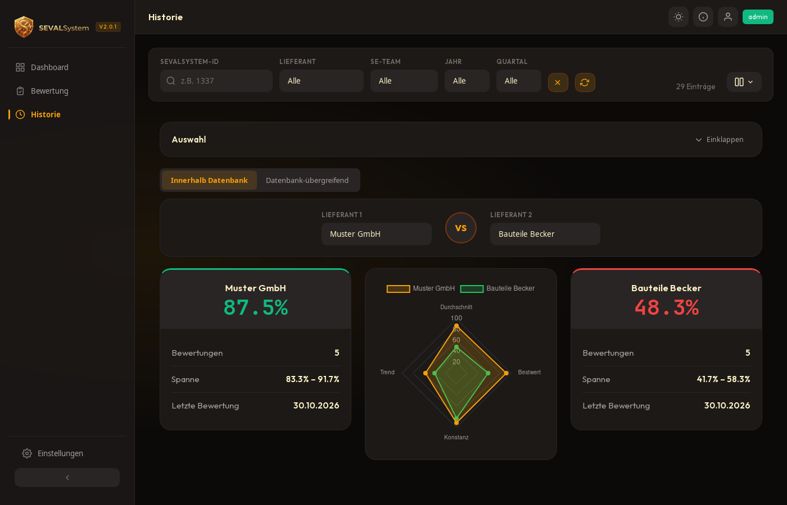
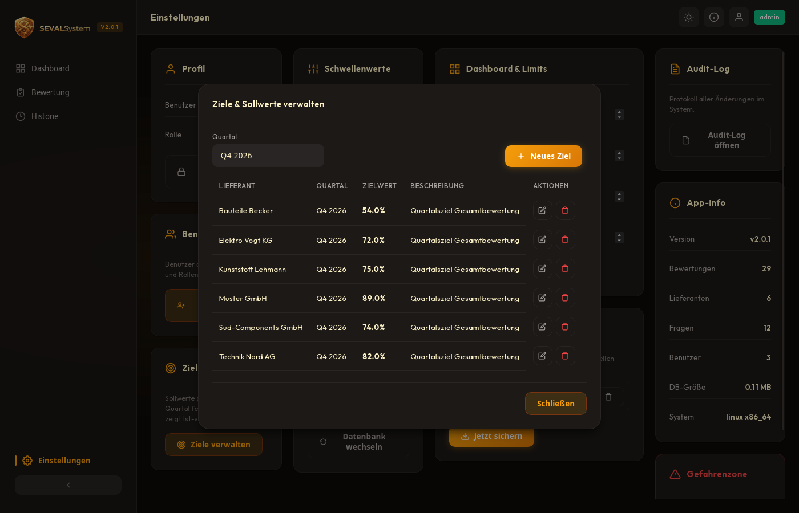
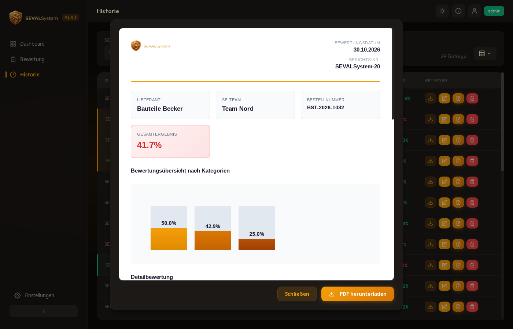
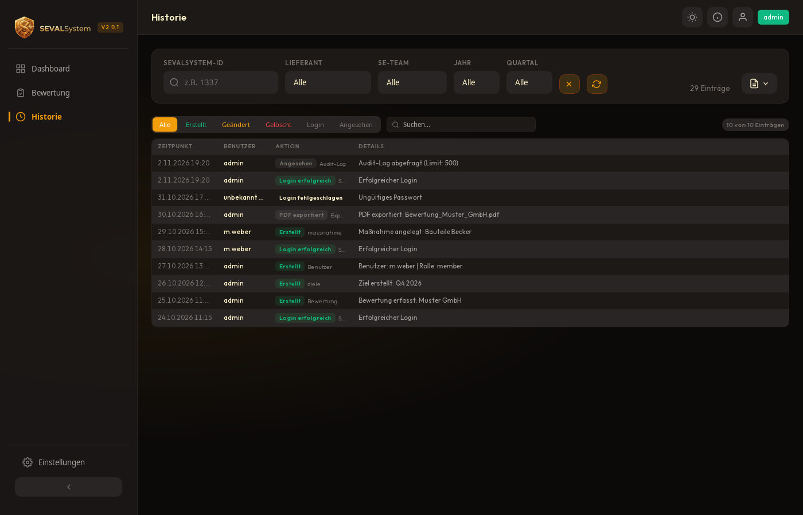
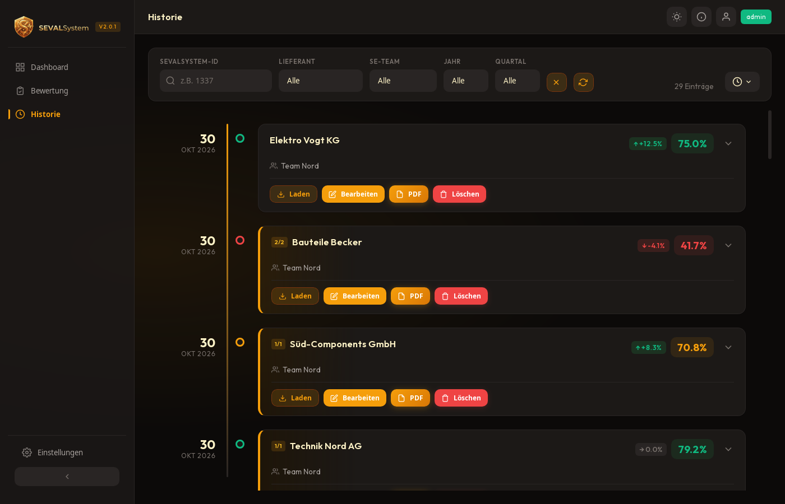
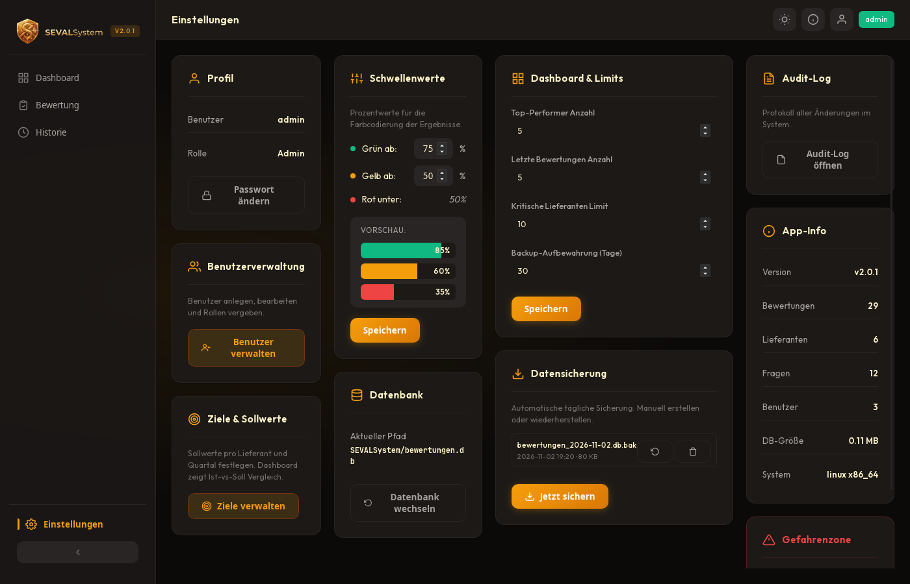
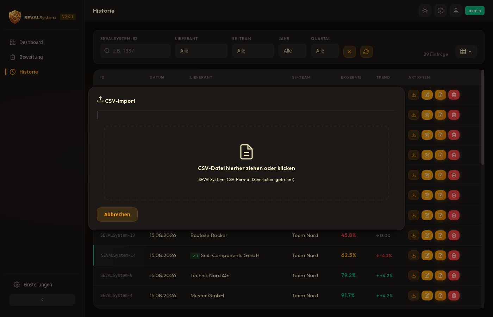
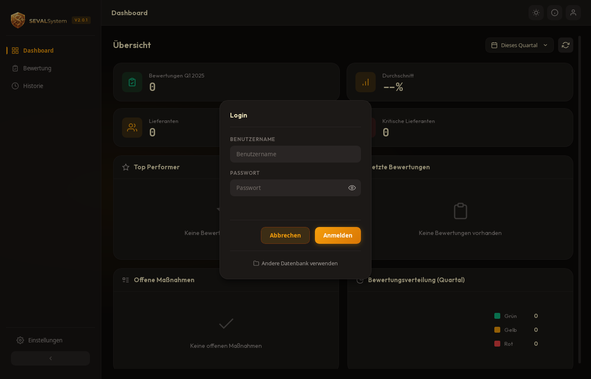
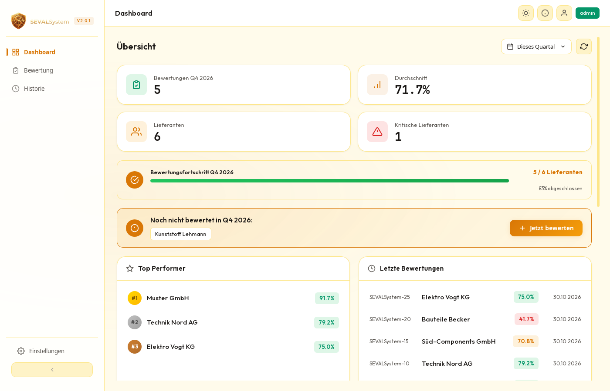
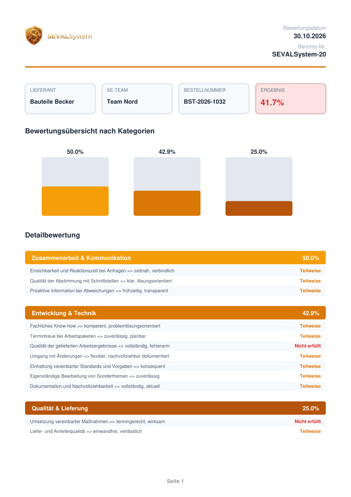

<p align="center">
  
</p>

<p align="center">
  <a href="LICENSE"></a>
  
  
  
  
  <a href="https://github.com/y0uall/sevalsystem/actions/workflows/ci.yml"></a>
</p>

# SEVALSystem – Lieferantenbewertung für den Mittelstand

**SEVALSystem** ist eine schlanke, vollständig lokale Desktop-Anwendung für die **strukturierte, quartalsweise Lieferantenbewertung**. Sie ersetzt die typische Excel-Liste durch einen geführten Bewertungsbogen mit gewichteten Kriterien, nachvollziehbaren Auswertungen, Maßnahmen-Tracking, Zielwerten, einem revisionssicheren Audit-Log und rollenbasierten Berechtigungen – ohne Cloud, Server oder externe Dienste.

Alle Daten liegen in einer einzigen SQLite-Datei auf dem eigenen Rechner oder einem Netzlaufwerk. **Keine Telemetrie, keine Internetverbindung nötig.**

> **English summary:** SEVALSystem is an offline desktop app (Tauri 2 + Rust + vanilla JS) for quarterly supplier evaluations: weighted questionnaires, dashboards and trends, action tracking, targets, PDF/XLSX/CSV export, role-based access and an audit trail. All data stays in a local SQLite file. The UI is currently German only. Licensed under MIT.

> **Download:** Fertige Installer für Windows (`.msi`/`.exe`) und Linux (`.deb`/`.AppImage`) liegen unter [Releases](https://github.com/y0uall/sevalsystem/releases/latest). Standard-Login `admin` / `admin123`, bitte sofort ändern.

---

## Screenshots

<p align="center">
  
</p>

<table>
  <tr>
    <td width="50%" valign="top">
      <br>
      <sub><b>Bewertungserfassung</b> – geführter Fragebogen mit Fortschritt, Live-Ergebnis und Maßnahmen aus dem Vorquartal</sub>
    </td>
    <td width="50%" valign="top">
      <br>
      <sub><b>Maßnahmen-Tracking</b> – Beschreibung, Verantwortliche und Fälligkeit direkt an der Bewertung</sub>
    </td>
  </tr>
  <tr>
    <td width="50%" valign="top">
      <br>
      <sub><b>Historie</b> – alle Bewertungen mit Filtern, Trendpfeilen und Maßnahmen-Status</sub>
    </td>
    <td width="50%" valign="top">
      <br>
      <sub><b>Trends &amp; Analysen</b> – Entwicklung über Zeit, Durchschnitt je Lieferant, Export als PNG/CSV/XLSX</sub>
    </td>
  </tr>
  <tr>
    <td width="50%" valign="top">
      <br>
      <sub><b>Lieferantenvergleich</b> – zwei Lieferanten im Spinnennetz-Diagramm, auch datenbankübergreifend</sub>
    </td>
    <td width="50%" valign="top">
      <br>
      <sub><b>Ziele &amp; Sollwerte</b> – Zielwerte je Lieferant und Quartal mit Ampel-Auswertung</sub>
    </td>
  </tr>
  <tr>
    <td width="50%" valign="top">
      <br>
      <sub><b>PDF-Export</b> – Einzelbewertung mit Logo, Kategorien-Diagramm und Detailbewertung</sub>
    </td>
    <td width="50%" valign="top">
      <br>
      <sub><b>Audit-Log</b> – revisionssicheres Protokoll aller Aktionen, filterbar und durchsuchbar</sub>
    </td>
  </tr>
</table>

<details>
<summary><b>Weitere Ansichten</b> (Timeline, Einstellungen, CSV-Import, Login, helles Design, erzeugtes PDF)</summary>
<br>
<table>
  <tr>
    <td width="50%" valign="top"><br><sub><b>Timeline</b> – chronologische Darstellung der Bewertungen</sub></td>
    <td width="50%" valign="top"><br><sub><b>Einstellungen</b> – Schwellenwerte, Limits, Benutzer, Backups, Datenbank</sub></td>
  </tr>
  <tr>
    <td width="50%" valign="top"><br><sub><b>CSV-Import</b> – Bewertungen aus bestehenden Listen übernehmen</sub></td>
    <td width="50%" valign="top"><br><sub><b>Login</b> – Benutzerkonten mit bcrypt-gesicherten Passwörtern</sub></td>
  </tr>
  <tr>
    <td width="50%" valign="top"><br><sub><b>Helles Design</b> – umschaltbar, Einstellung wird gespeichert</sub></td>
    <td width="50%" valign="top"><br><sub><b>Erzeugtes PDF</b> – Seite 1 einer exportierten Einzelbewertung</sub></td>
  </tr>
</table>
</details>

Alle Screenshots zeigen die mitgelieferten **Demo-Daten** (frei erfundene Lieferanten, siehe [Demo-Datenbanken](#demo-datenbanken)).

---

## Funktionsumfang

- **Dashboard** – Kennzahlen zum aktuellen Quartal, Bewertungsfortschritt, fehlende Bewertungen mit direktem Sprung zur Erfassung, Top-Performer, kritische Lieferanten, Bewertungsverteilung (Ampel), offene und überfällige Maßnahmen, Zielerreichung.
- **Bewertungserfassung** – Geführter Fragebogen mit **Gewichtung je Frage (1–10)**, Kommentar je Kategorie, Bestellnummer, Dublettenprüfung und **serverseitiger Score-Berechnung** im Rust-Backend. Offene Maßnahmen des Vorquartals werden automatisch eingeblendet und können als umgesetzt bestätigt werden.
- **Maßnahmen-Tracking** – Strukturierte Maßnahmen mit Verantwortlichem, Fälligkeitsdatum und Status (offen, in Bearbeitung, erledigt); überfällige Maßnahmen werden beim Start automatisch markiert.
- **Ziele & Sollwerte** – Zielwerte je Lieferant und Quartal, Ampel-Auswertung (erreicht / knapp / verfehlt) und Ziellinie im Trenddiagramm.
- **Historie & Analysen** – Tabelle mit Pagination, Timeline, Trend- und Kategorie-Diagramme, Statistik (Median, Standardabweichung, Perzentile, Jahresvergleich), Lieferantenvergleich; Filter nach Lieferant, SE-Team, Jahr und Quartal.
- **Datenbankübergreifender Vergleich** – Mehrere Bewertungsdatenbanken (z. B. je Team oder Standort) schreibgeschützt nebeneinander auswerten.
- **Import & Export** – CSV-Import mit Validierung und Dublettenerkennung; Export als **PDF** (Einzelbewertung und Quartalsbericht), **XLSX**, **CSV** (Excel-kompatibel, deutsches Format) und **PNG**.
- **Audit-Log** – Revisionssicher, filterbar und durchsuchbar; Team-Mitglieder sehen nur eigene Einträge, Controlling/Administrator das gesamte Protokoll.
- **Backups** – Tägliche automatische Sicherung mit konfigurierbarer Aufbewahrung; Backups lassen sich in der App auflisten, erstellen, wiederherstellen und löschen.
- **Benutzer & Rechte** – Drei Rollen, bcrypt-Passwörter, Passwort-Reset durch den Administrator, Aufforderung zum Ändern des Standard-Passworts.
- **Komfort** – Dunkles und helles Design, Tastaturbedienung, Datenbankwechsel zur Laufzeit, Splash Screen.

Der mitgelieferte **Fragenkatalog** (drei Kategorien, zwölf Kriterien) ist ein neutraler Ausgangspunkt und lässt sich im Admin-Bereich vollständig anpassen. Der Begriff **SE-Team** steht für die Organisationseinheit, die eine Bewertung abgibt (z. B. Abteilung, Projektteam oder Standort) – die Bezeichnungen sind frei wählbar.

### Rollenmodell

| Rolle | Rechte |
|---|---|
| `admin` | Vollzugriff: Benutzerverwaltung, Einstellungen, Fragenkatalog, Ziele, Backups, Datenbankwechsel, datenbankübergreifender Vergleich, gesamtes Audit-Log |
| `member` | Bewertungen und Maßnahmen anlegen, eigene Bewertungen bearbeiten, Lieferanten/SE-Teams anlegen, Exporte, CSV-Import, eigene Audit-Einträge |
| `controlling` | Alle Bewertungen einsehen und bearbeiten, Maßnahmen-Status pflegen, Exporte, Datenbankwechsel, eigene Audit-Einträge |

Die vollständige Berechtigungsmatrix steht in [docs/FEATURES_UND_BERECHTIGUNGEN.md](docs/FEATURES_UND_BERECHTIGUNGEN.md).

---

## Dokumentation

| Dokument | Inhalt |
|---|---|
| [Benutzerhandbuch](docs/BENUTZERHANDBUCH.md) | Bedienung Schritt für Schritt: Bewerten, Dashboard, Historie, Berichte, Maßnahmen |
| [IT-Handbuch](docs/IT-HANDBUCH.md) | Installation, Speicherorte, Sicherheitskonzept, Betrieb im Team, Backup, Problembehandlung |
| [Features & Berechtigungen](docs/FEATURES_UND_BERECHTIGUNGEN.md) | Funktionsübersicht und Berechtigungsmatrix je Rolle |
| [Berechnungslogik](docs/BERECHNUNG.md) | Wie Punkte, Gewichtung und Gesamtergebnis berechnet werden |
| [Changelog](CHANGELOG.md) | Änderungen je Version |

---

## Technischer Aufbau

- **Frontend:** Vanilla JavaScript, HTML und modulares CSS – kein Framework, kein Build-Schritt. Gebündelt: Chart.js 4, jsPDF 4, html2canvas.
- **Backend:** [Tauri 2](https://tauri.app) mit Rust (Edition 2024), SQLite über `rusqlite` (statisch gebündelt), `bcrypt`, `chrono`, `rust_xlsxwriter`.
- **Sicherheit:** bcrypt (Cost 10), durchgängig parametrisierte SQL-Abfragen, restriktive Content Security Policy, aktive Fremdschlüssel, Pfad- und Größenprüfung bei Exporten, Rechteprüfung im Backend, keine Netzwerkzugriffe.

```
sevalsystem/
├── ui/              Frontend (index.html, app.js, styles.css, lib/, fonts/)
├── src-tauri/       Rust-Backend, Tauri-Konfiguration, Icons
│   └── src/         lib.rs (Datenbank & Commands), models.rs, backup.rs
├── demo/            Generator für Demo-Datenbanken
├── docs/            Handbücher und Berechnungslogik
├── screenshots/     Bilder für diese README
└── .github/         CI- und Release-Workflows
```

---

## Voraussetzungen

- **Rust** (aktuelle stabile Toolchain) – Installation via [rustup](https://rustup.rs)
- **Tauri CLI 2:** `cargo install tauri-cli --version "^2"`
- **Linux:** zusätzlich die Systempakete
  ```bash
  sudo apt install libwebkit2gtk-4.1-dev libgtk-3-dev librsvg2-dev \
                   libjavascriptcoregtk-4.1-dev libglib2.0-dev libssl-dev
  ```
- **Windows:** WebView2-Runtime (auf aktuellen Windows-Versionen bereits vorhanden) und die Visual-Studio-Build-Tools (C++)
- **macOS:** Xcode Command Line Tools

Das Frontend ist statisch – Node.js wird nicht benötigt.

## Bauen & Starten

```bash
# Entwicklungsmodus
cargo tauri dev

# Produktions-Build (Installer unter target/release/bundle/)
cargo tauri build
```

Alternativ ohne Tauri-CLI: `cargo run` im Verzeichnis `src-tauri`.

### Tests & Qualität

```bash
cargo test      # Unit- und Integrationstests des Backends
cargo clippy    # statische Analyse (CI: ohne Warnungen)
```

Die Workflows unter `.github/workflows/` führen bei jedem Push Tests und Clippy auf Ubuntu und Windows aus und bauen bei einem Tag der Form `v2.0.1` Installer für Windows (`.msi`, `.exe`) und Linux (`.deb`, `.AppImage`) als Release-Entwurf. In einem Fork sind sie ohne Anpassung nutzbar.

---

## Erststart

Beim ersten Start fragt die App nach dem Speicherort der Datenbank (Standard siehe unten) und legt sie mit dem Beispiel-Fragenkatalog und einem Standard-Administrator an:

- **Benutzername:** `admin`
- **Passwort:** `admin123`

> ⚠️ **Bitte das Passwort sofort ändern.** Beim ersten Login erscheint ein entsprechender Hinweis.

### Speicherort der Daten

| System | Datenbank (Standard) |
|---|---|
| Windows | `%APPDATA%\sevalsystem\SEVALSystem\data\bewertungen.db` |
| Linux | `~/.local/share/sevalsystem/bewertungen.db` |
| macOS | `~/Library/Application Support/de.sevalsystem.SEVALSystem/bewertungen.db` |

Für die gemeinsame Nutzung im Team kann die Datenbank auf einem Netzlaufwerk liegen. Automatische Backups landen im Unterordner `backups/` neben der Datenbank. Details im [IT-Handbuch](docs/IT-HANDBUCH.md).

### Demo-Datenbanken

Zum Ausprobieren liegt unter `demo/` ein Generator für zwei gefüllte Beispiel-Datenbanken (sechs erfundene Lieferanten, fünf Quartale, Maßnahmen, Ziele, Audit-Log – alle Daten relativ zum heutigen Datum):

```bash
pip install bcrypt
python3 demo/build_demo_dbs.py      # erzeugt demo/demo-team-nord.db und demo/demo-team-sued.db
```

In der App über **„Andere Datenbank verwenden"** im Login-Dialog (oder *Einstellungen → Datenbank wechseln*) eine der Dateien öffnen und mit `admin` / `admin123` anmelden. Die zweite Datenbank eignet sich für den datenbankübergreifenden Vergleich.

---

## Datenschutz

SEVALSystem ist eine reine Offline-Anwendung. Es werden keine Daten an Dritte übertragen, es gibt keine Telemetrie, kein Auto-Update und keine Cloud-Komponente. Sämtliche Bewertungs- und Personendaten verbleiben in der lokalen Datenbank unter der Kontrolle des Betreibers.

## Projektstatus

SEVALSystem ist abgeschlossen und wird nicht weiterentwickelt. Das Repository ist **archiviert** und damit schreibgeschützt; Issues und Pull Requests sind deshalb nicht möglich. **Forks sind ausdrücklich erwünscht:** Die MIT-Lizenz erlaubt es, die Anwendung frei zu übernehmen, anzupassen und weiterzuführen, auch kommerziell. Naheliegende nächste Schritte für einen Fork wären eine mehrsprachige Oberfläche und die Aufteilung von `app.js` in Module.

## Lizenz

Veröffentlicht unter der **MIT-Lizenz** – siehe [LICENSE](LICENSE). Freie Nutzung, Anpassung und Weitergabe, auch kommerziell, sind ausdrücklich erlaubt.

© 2026 Michael Schlosser
