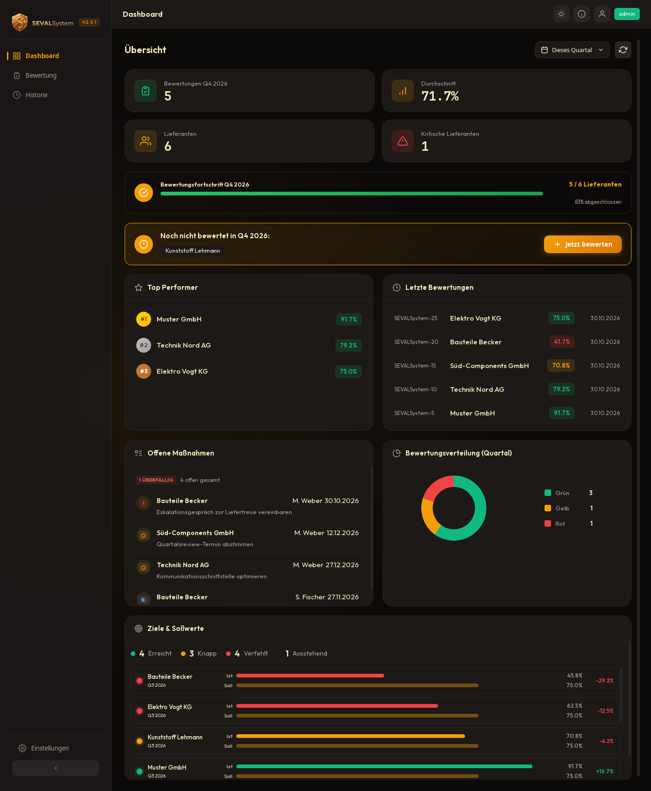
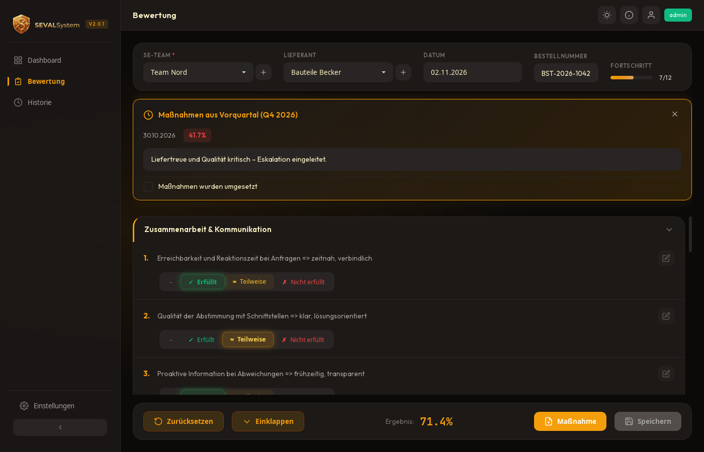
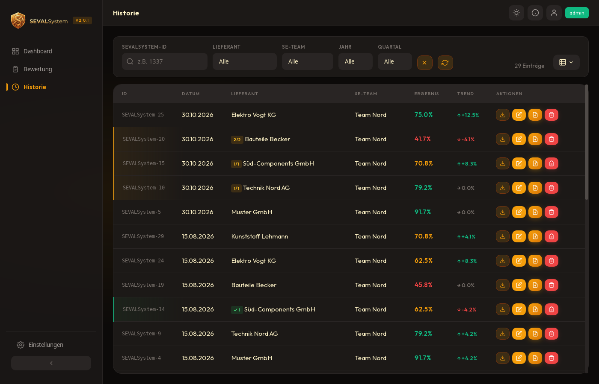
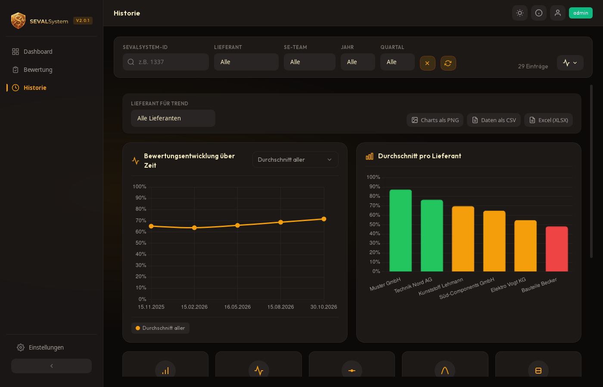
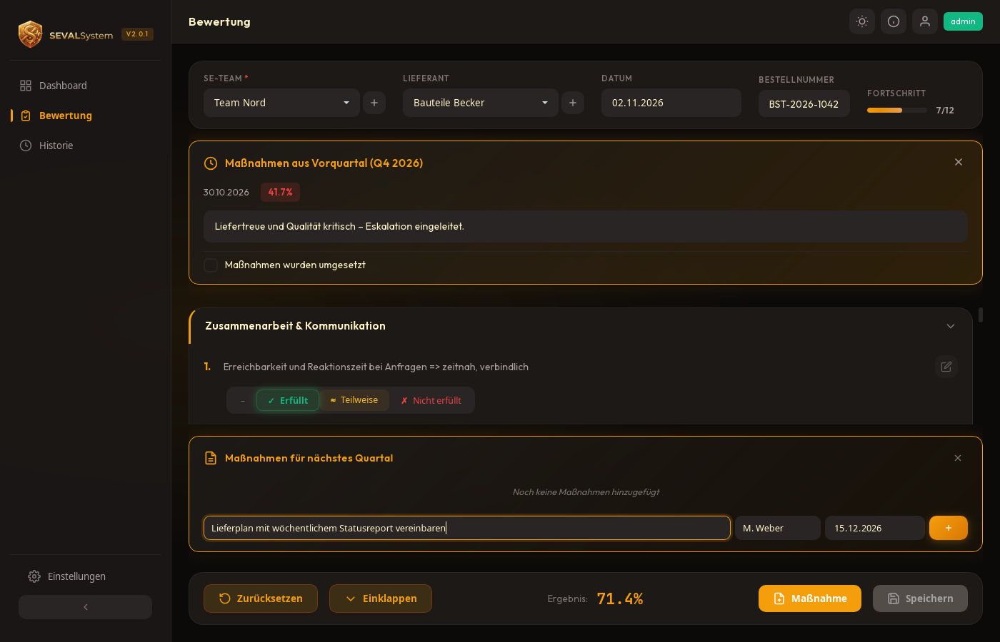

# SEVALSystem

**SEVALSystem** ist eine schlanke, vollständig lokale Desktop-Anwendung zur **strukturierten, quartalsweisen Lieferantenbewertung**. Sie wurde für den praktischen Einsatz im Mittelstand entwickelt: ein geführter Bewertungsbogen, nachvollziehbare Auswertungen, ein revisionssicheres Audit-Log und rollenbasierte Berechtigungen – ganz ohne Cloud, Server oder externe Dienste.

Alle Daten bleiben in einer lokalen SQLite-Datenbank auf dem eigenen Rechner oder einem Netzlaufwerk. Es gibt **keine Telemetrie und keine Cloud-Anbindung**.

> Hinweis: Der mitgelieferte Fragenkatalog besteht aus **generischen Beispiel-Kriterien**. Er ist als Ausgangspunkt gedacht und lässt sich im Admin-Bereich vollständig an die eigenen Anforderungen anpassen.

---

## Screenshots

<p align="center">
  
</p>

<table>
  <tr>
    <td width="50%" valign="top">
      <br>
      <sub><b>Bewertungserfassung</b> – geführter Fragebogen mit Gewichtung je Frage</sub>
    </td>
    <td width="50%" valign="top">
      <br>
      <sub><b>Historie</b> – Tabelle mit Filtern und Export</sub>
    </td>
  </tr>
  <tr>
    <td width="50%" valign="top">
      <br>
      <sub><b>Trends &amp; Analysen</b> – Zeitreihen und Kategorie-Verläufe</sub>
    </td>
    <td width="50%" valign="top">
      <br>
      <sub><b>Maßnahmen-Tracking</b> – Status, Verantwortliche und Fälligkeiten</sub>
    </td>
  </tr>
</table>

<sub>Bilder ablegen unter <code>screenshots/</code> — Namenskonvention und Tipps siehe <a href="screenshots/README.md">screenshots/README.md</a>.</sub>

---

## Funktionsumfang

- **Dashboard** – Kennzahlen zum aktuellen Quartal, offene und überfällige Maßnahmen, Top-Performer, Bewertungsverteilung (Ampel), Zielerreichung und fehlende Bewertungen mit direktem Sprung in die Details.
- **Bewertungserfassung** – Geführter Fragebogen mit **Gewichtung je Frage**, Kommentar je Kategorie, Übernahme des Vorquartals-Status, Dublettenprüfung und **serverseitiger Score-Berechnung** (das Ergebnis wird nicht dem Frontend „geglaubt").
- **Maßnahmen-Tracking** – Strukturierte Maßnahmen mit Verantwortlichem, Fälligkeitsdatum und Status; überfällige Maßnahmen werden automatisch markiert.
- **Ziele & Sollwerte** – Zielwerte je Lieferant und Quartal inklusive Ampel-Auswertung (erreicht / knapp / verfehlt).
- **Historie & Analysen** – Tabelle, Timeline, Trend-Diagramme, Kategorie-Trends und Lieferantenvergleich; Filter nach Lieferant, SE-Team und Zeitraum.
- **Datenbankübergreifender Vergleich** – Mehrere Bewertungsdatenbanken schreibgeschützt nebeneinander auswerten (nur Administrator).
- **Import & Export** – CSV-Import mit Validierung und Dublettenerkennung (transaktional); Export als **PDF** (mit Logo), **PNG**, **XLSX** (formatiert, deutschlandkompatibel) und **CSV**.
- **Audit-Log** – Revisionssicher und filterbar; Team-Mitglieder sehen nur eigene Einträge, Controlling/Administrator die gesamte Historie.
- **Automatische Backups** – Tägliche Sicherung der Datenbank mit konfigurierbarer Aufbewahrungsdauer; Backups lassen sich auflisten, erstellen, wiederherstellen und löschen.
- **Benutzer- & Rechteverwaltung** – Drei Rollen (siehe unten), bcrypt-Passwörter, Mindestlänge, Passwort-Reset durch Administrator.
- **Komfort** – Dark-/Light-Theme, Tastaturbedienung, Datenbankwechsel zur Laufzeit.

### Rollenmodell

| Rolle | Rechte |
|---|---|
| `admin` | Vollzugriff: Benutzerverwaltung, Einstellungen, Datenbankwechsel, datenbankübergreifender Vergleich, gesamtes Audit-Log |
| `member` | Bewertungen & Maßnahmen pflegen, Stammdaten (Lieferanten/SE-Teams) verwalten, eigene Audit-Einträge |
| `controlling` | Lese-/Exportrechte für alle Bewertungen, eigene Audit-Einträge, Datenbankwechsel |

---

## Technischer Aufbau

- **Frontend:** Vanilla JavaScript + modulares CSS (keine Framework-Abhängigkeit), Chart.js, jsPDF, html2canvas.
- **Backend:** [Tauri 2](https://tauri.app) + Rust, SQLite über `rusqlite` (gebündelt), `bcrypt`, `chrono`, `rust_xlsxwriter`.
- **Sicherheit:** bcrypt (Cost 10), durchgängig parametrisierte SQL-Abfragen, restriktive Content-Security-Policy, referenzielle Integrität (Foreign Keys aktiv), Pfad- und Größenprüfung bei Exporten, keine Klartext-Passwörter.

---

## Voraussetzungen

- **Rust** (aktuelle stabile Toolchain, Edition 2024) – Installation via [rustup](https://rustup.rs)
- **Tauri CLI 2:** `cargo install tauri-cli --version "^2"`
- **Linux** zusätzlich die Systempakete:
  ```bash
  sudo apt install libglib2.0-dev libgtk-3-dev libwebkit2gtk-4.1-dev \
                   libjavascriptcoregtk-4.1-dev librsvg2-dev
  ```
- **Windows:** WebView2-Runtime (auf aktuellen Windows-Versionen bereits vorhanden)

Das Frontend ist statisch (kein Node.js-Build erforderlich).

## Bauen & Starten

```bash
# Entwicklungsmodus (mit Hot-Reload-Fenster)
cargo tauri dev

# Produktions-Build (Installer/Bundle unter src-tauri/target/release/)
cargo tauri build
```

Alternativ ohne Tauri-CLI: `cargo run` im Verzeichnis `src-tauri`.

### Tests

```bash
cd src-tauri
cargo test        # Unit- und Integrationstests
cargo clippy      # statische Analyse
```

---

## Erststart

Beim ersten Start wird automatisch eine leere Datenbank mit dem Beispiel-Fragenkatalog und einem Standard-Administrator angelegt:

- **Benutzername:** `admin`
- **Passwort:** `admin123`

> ⚠️ **Bitte das Passwort sofort ändern.** Beim ersten Login erscheint ein entsprechender Hinweis. Solange das Standard-Passwort aktiv ist, ist die Installation nicht abgesichert.

### Speicherort der Daten

Standardmäßig liegt die Datenbank im Benutzerprofil (ein abweichender Pfad ist in der App wählbar):

- **Windows:** `%APPDATA%\sevalsystem\SEVALSystem\data\bewertungen.db`
- **Linux/macOS:** im OS-üblichen App-Datenverzeichnis (`~/.local/share/…` bzw. `~/Library/Application Support/…`)

Automatische Backups landen im Unterordner `backups/` neben der Datenbank.

---

## Fragenkatalog anpassen

Die Bewertungskriterien sind frei konfigurierbar. Als Administrator lassen sich im Bereich **Fragen verwalten** Kategorien und Fragen anlegen, bearbeiten, gewichten und löschen. Der mitgelieferte Standardkatalog (drei Beispielkategorien) dient nur als neutraler Startpunkt.

---

## Datenschutz

SEVALSystem ist eine reine Offline-Anwendung. Es werden keine Daten an Dritte übertragen, es gibt keine Telemetrie und keine Cloud-Komponente. Sämtliche Bewertungs- und Personendaten verbleiben in der lokalen Datenbank unter der Kontrolle des Betreibers.

## Mitwirken

Beiträge sind willkommen. Bitte Issues für Fehler und Vorschläge anlegen oder einen Pull Request einreichen. Vor größeren Änderungen empfiehlt sich eine kurze Abstimmung im Issue-Tracker.

## Lizenz

Veröffentlicht unter der **MIT-Lizenz** – siehe [LICENSE](LICENSE). Damit ist die freie Nutzung, Anpassung und Weitergabe (auch kommerziell) ausdrücklich gestattet.

© 2026 Michael Schlosser

Die Berechnungslogik der Bewertungen ist in [README_BERECHNUNG.md](README_BERECHNUNG.md) dokumentiert.
